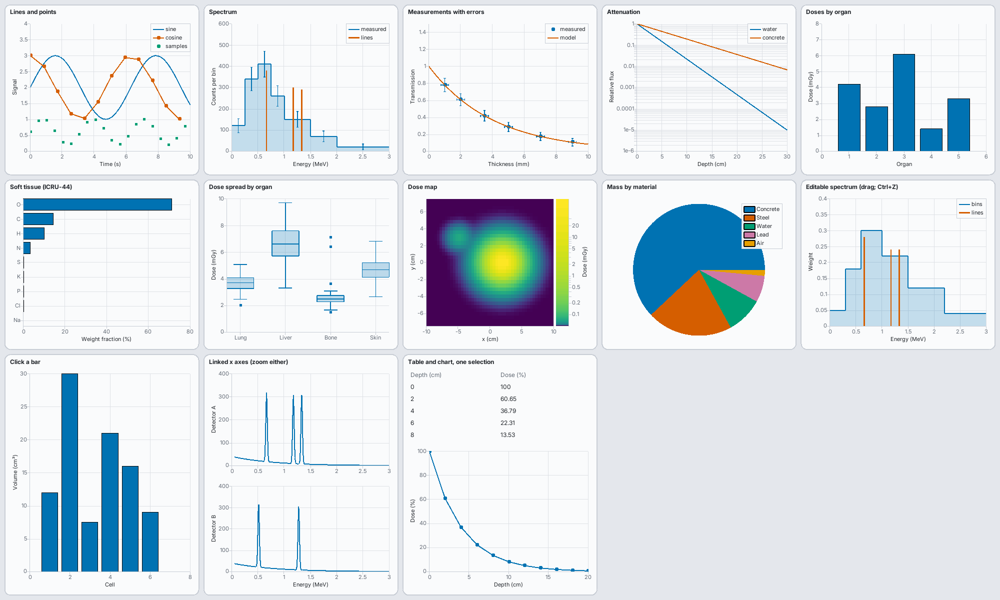
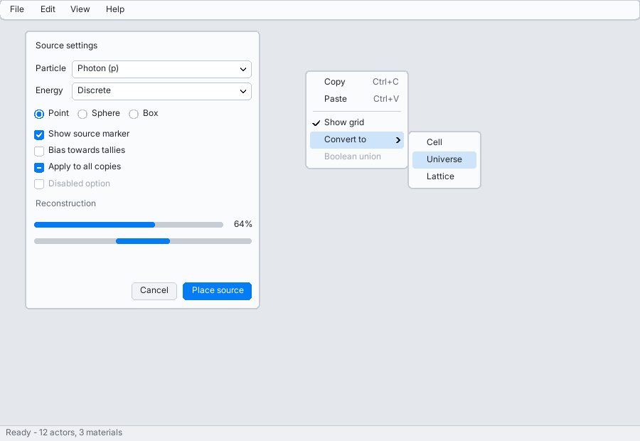
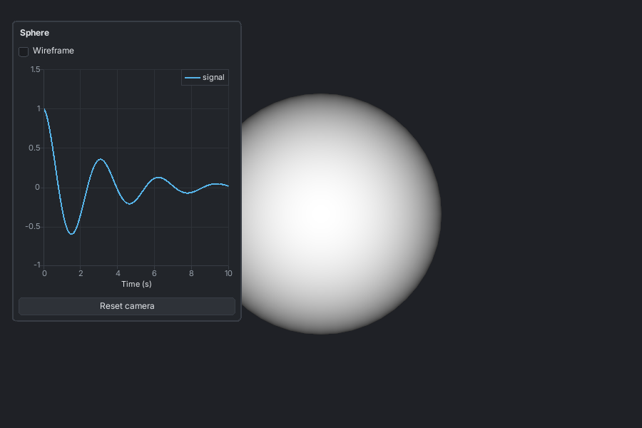

# MultiPanel

**MultiPanel: a UI framework built with VTK.**

MultiPanel draws application user interfaces inside a VTK render window:
panels, docks, buttons, text fields, sliders, menus, item views, charts and
popups, laid out and driven like Qt widgets but rendered by VTK's own 2D
pipeline. It needs only VTK and NumPy, so the same UI runs in a plain
`vtkRenderWindow`, inside Qt, or off-screen.



> MultiPanel is an independent project and is not affiliated with, sponsored
> by or endorsed by Kitware, Inc. "VTK" is a registered trademark of Kitware,
> Inc. MultiPanel is alpha software: APIs may still change.

## Features

- **Widgets with a Qt-style API**: signals (`clicked.connect(...)`), focus and
  Tab order, enable/visible state, tool tips, `saveState`/`restoreState`,
  while VTK calls such as `SetEnabled` and `AddObserver` keep working.
- **Layouts**: `VBoxLayout`, `HBoxLayout`, `GridLayout`, `FormLayout`,
  `Splitter`, `ScrollArea`, dockable panes and tabs, in pixel or
  viewport-fraction units, DPI-aware across displays.
- **Event routing**: one router decides whether input belongs to the UI or
  the 3D scene (hit-testing, mouse grabs, wheel, hover, context menus,
  keyboard focus), so camera interaction and UI never fight.
- **Text editing**: single-line fields with a caret, selection, clipboard,
  undo, input masks and completion; a multi-line `TextEdit`.
- **Standard controls**: labels, push buttons, check boxes, radio buttons,
  combo boxes, menus and a menu bar, progress bars, message boxes, a status
  bar, list/tree/table views on item models.
- **Charts** on `vtkChartXY`: lines, scatter, bars, histograms, error bars
  in x and y, box plots, 2D histograms, pies; editable series, linked axes,
  model binding, tool tips, a context menu, and export to PNG, SVG, PDF and
  CSV.
- **Theming**: light and dark themes with an accent colour, shared with Qt
  applications through an optional Qt theme module.
- **Testing helpers**: `UiHarness` drives any UI with synthetic mouse and
  keyboard events, off-screen, for pytest.



## Installation

MultiPanel needs Python 3.10 or newer and VTK 9.3 or newer (it is tested with
VTK 9.5 and 9.6).

```bash
python -m pip install "multipanel @ git+https://github.com/fraseyboo/MultiPanel"
```

or, from a clone, for development:

```bash
git clone https://github.com/fraseyboo/MultiPanel
cd MultiPanel
python -m pip install -e ".[test]"
```

Optional features are grouped as extras:

```bash
python -m pip install "multipanel[scientific]"  # plotting, probes, reconstruction
python -m pip install "multipanel[icons]"       # SVG/PNG icon conversion
python -m pip install "multipanel[qt6]"         # Qt theme integration (or qt5)
python -m pip install "multipanel[full]"        # scientific + icons
```

Prebuilt icons ship with the package; the `icons` extra is only needed to
convert new ones. A feature used without its extra raises an error naming the
extra to install.

## Quick start

A panel with a check box, a chart and a button over a 3D scene
([examples/quickstart.py](examples/quickstart.py)):

```python
import numpy as np
import vtk

from multipanel.chartview import ChartView, XYChart
from multipanel.config import theme
from multipanel.containers import Frame
from multipanel.layouts import VBoxLayout
from multipanel.router import EventRouter
from multipanel.standard import CheckBox, Label, PushButton
from multipanel.units import frac, px

renderer = vtk.vtkRenderer()
renderer.theme = theme()                     # UI colour tokens
window = vtk.vtkRenderWindow()
window.SetSize(900, 600)
window.AddRenderer(renderer)
interactor = vtk.vtkRenderWindowInteractor()
interactor.SetRenderWindow(window)
interactor.SetInteractorStyle(vtk.vtkInteractorStyleTrackballCamera())
EventRouter.install(interactor)              # routes input to the UI

source = vtk.vtkSphereSource()
mapper = vtk.vtkPolyDataMapper()
mapper.SetInputConnection(source.GetOutputPort())
sphere = vtk.vtkActor()
sphere.SetMapper(mapper)
renderer.AddActor(sphere)

panel = Frame(renderer, interactor, background=True,
              geometry=(frac(0.02), frac(0.25), px(320), px(420)))
wireframe = CheckBox(renderer, interactor, "Wireframe")
wireframe.toggled.connect(lambda on: (
    sphere.GetProperty().SetRepresentation(1 if on else 2), window.Render()))
chart = XYChart()
x = np.linspace(0, 10, 200)
chart.addLine(x, np.exp(-x / 3) * np.cos(2 * x), name="signal")
view = ChartView(renderer, interactor, chart)
view.setMinimumHeight(px(220))
reset = PushButton(renderer, interactor, "Reset camera")
reset.clicked.connect(lambda: (renderer.ResetCamera(), window.Render()))

column = VBoxLayout(margins=(8, 8, 8, 8), spacing=6)
column.addWidget(Label(renderer, interactor, "Sphere", bold=True))
column.addWidget(wireframe)
column.addWidget(view, stretch=1)
column.addWidget(reset)
panel.setLayout(column)

window.Render()
interactor.Initialize()
interactor.Start()
```



## Examples

Each example runs interactively; most also take `--screenshot out.png` to
render one frame off-screen.

| Example | Shows |
| --- | --- |
| [quickstart.py](examples/quickstart.py) | a panel with controls and a chart over a scene |
| [gallery.py](examples/gallery.py) | the standard controls, menus and message boxes |
| [chart_gallery.py](examples/chart_gallery.py) | every chart type, live (`T` toggles the theme) |
| [chart_panel_demo.py](examples/chart_panel_demo.py) | charts docked in a side pane |
| [layout_demo.py](examples/layout_demo.py) | box and form layouts in a panel |
| [scroll_demo.py](examples/scroll_demo.py) | a scroll area inside a panel |
| [views_demo.py](examples/views_demo.py) | list, tree and table views on item models |
| [textedit_demo.py](examples/textedit_demo.py) | a multi-line editor and a live log |
| [basic_controls.py](examples/basic_controls.py) | the classic slider and text controls |
| [specialists_demo.py](examples/specialists_demo.py) | scene tools (needs the `scientific` extra) |

## Documentation

- [API guide](docs/API.md): the widget, layout, chart and event APIs
- [Layouts](docs/LAYOUTS.md): coordinates, size negotiation and docking
- [Architecture](docs/ARCHITECTURE.md): modules and their dependencies
- [Qt parity proposal](docs/QT_PARITY_PROPOSAL.md) and
  [charts proposal](docs/CHARTS_PROPOSAL.md): design records
- [Changelog](CHANGELOG.md)

## Running the tests

```bash
python -m pytest -q
```

The tests render off-screen; on Linux without a display, run them under
`xvfb-run`.

## Renamed from VTK-2D-UI

The project was previously called VTK-2D-UI, with the package `vtk_2d_ui`. To
avoid any suggestion of being an official VTK project it is now MultiPanel,
with the package `multipanel`. `import vtk_2d_ui` still works for now (it
returns the `multipanel` modules and warns); it will be removed in a future
release.

## License

MultiPanel is released under the [BSD 3-Clause License](LICENSE), the same
license as VTK. It bundles the Inter typeface (SIL Open Font License 1.1)
and the Open Sans typeface (Apache License 2.0); see
[THIRD_PARTY_NOTICES.md](THIRD_PARTY_NOTICES.md).
